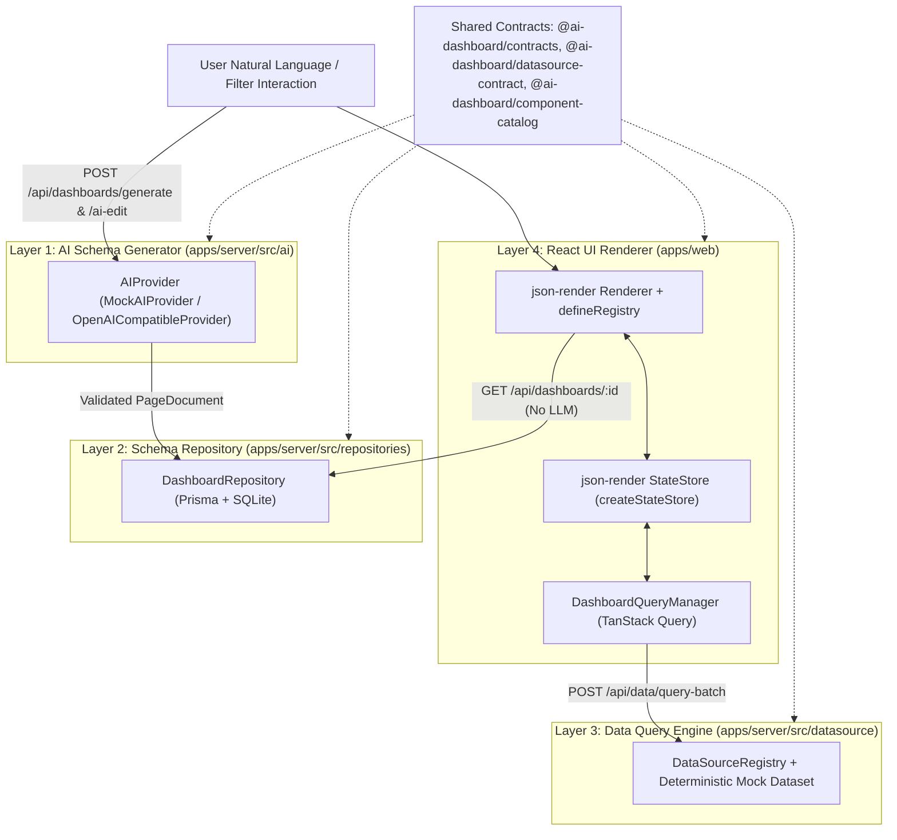

# System Architecture

## Overview

**AI Generative Dashboard Platform V2** is a full-stack Generative UI BI platform built on top of [`@json-render/core`](https://github.com/vercel-labs/json-render) and [`@json-render/react`](https://json-render.dev/docs/api/react).

Instead of allowing LLMs to output arbitrary React code, raw CSS, or SQL queries, the platform enforces a strict four-layer contract architecture:

## Four Architectural Layers

1. **Layer 1 — AI Schema Generator (`apps/server/src/ai`)**
   - Consumes public Component Catalog metadata, authorized DataSource Catalog metadata, and user intent.
   - Outputs a candidate `PageDocument` (for generation) or controlled RFC 6902 JSON Patches via `@json-render/core`'s `applySpecPatch` / `diffToPatches` (for incremental editing while preserving unrelated node IDs).
   - Server always runs the 14-point validator (`validatePageDocument`) before returning results.
2. **Layer 2 — Schema Repository (`apps/server/src/repositories`)**
   - Persists `Dashboard` metadata and immutable `DashboardRevision` snapshots in SQLite via Prisma.
   - Enforces optimistic locking (`baseRevision` check returning `409 REVISION_CONFLICT` on stale updates).
   - Persists only declarative `PageDocument` definitions (UI Spec + queries + variables); runtime business query results are never stored in `DashboardRevision`.
3. **Layer 3 — Data Query Engine (`apps/server/src/datasource` + `apps/web/src/data/query-manager.ts`)**
   - Backend `DataSourceRegistry` validates resource IDs, RBAC roles, Zod params, and Zod results, with per-user TTL caching and independent batch error isolation.
   - Frontend `DashboardQueryManager` resolves `$var` references, computes variable dependencies, deduplicates equivalent queries into canonical cache keys, fetches via `POST /api/data/query-batch`, and writes results into the controlled `json-render` `StateStore`.
4. **Layer 4 — React UI Renderer (`apps/web/src/renderer`)**
   - Uses official `defineCatalog` + `defineRegistry` + `JSONUIProvider` + `Renderer` from `@json-render/core` and `@json-render/react`.
   - Binds 21 composable BI layout, ECharts visualization, Ant Design table, and filter/action components.
   - All interactions (`setVariable`, `refreshData`, `changeTab`, `navigate`) flow through registered action handlers—zero inline JavaScript functions in Schema.

## Package Dependency Graph (Acyclic)

- `@ai-dashboard/contracts` → `@json-render/core`, `zod`
- `@ai-dashboard/datasource-contract` → `@ai-dashboard/contracts`, `zod`
- `@ai-dashboard/component-catalog` → `@ai-dashboard/contracts`, `@ai-dashboard/datasource-contract`, `@json-render/core`, `@json-render/react`, `zod`
- `@ai-dashboard/server` → all 3 packages + Fastify + Prisma
- `@ai-dashboard/web` → all 3 packages + React 18 + Rsbuild + Ant Design 5 + ECharts + TanStack Query

## Engineering Decisions

- **Installed `json-render` Version**: `@json-render/core@0.23.2` and `@json-render/react@0.23.2`. Its `catalog.validate(spec)` validates raw element props directly against each component's Zod schema, so bindable props in `dashboardCatalog` explicitly accept both literal values and `{ $state }` / `{ $bindState }` expressions.
- **React 18 Compatibility**: Verified `@json-render/react@0.23.2` only imports standard React 18 hooks (`useSyncExternalStore`, `useContext`, etc.); `pnpm-workspace.yaml` configures `peerDependencyRules.allowedVersions.react: "18"`.
- **Zod v4**: `@json-render/core@0.23.2` depends on `zod@^4.3.6`, so all workspace packages share Zod v4 uniformly.
- **Server-Side Identity**: Demo authentication is resolved strictly from server-side environment variables (`DEMO_USER_ID`, `DEMO_USER_ROLES`), never from client-provided `ownerId`.
